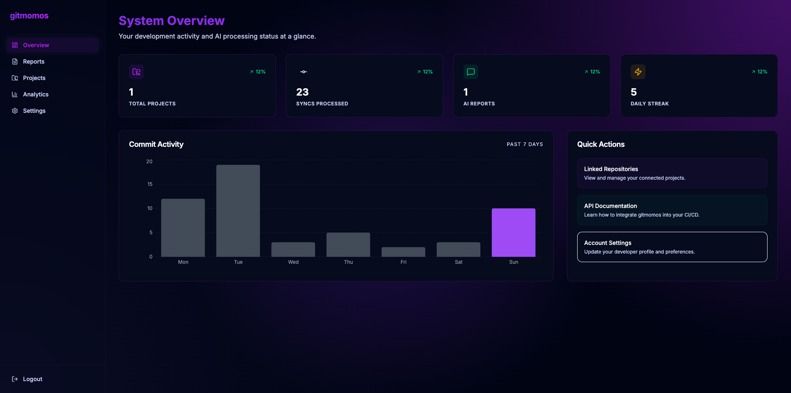
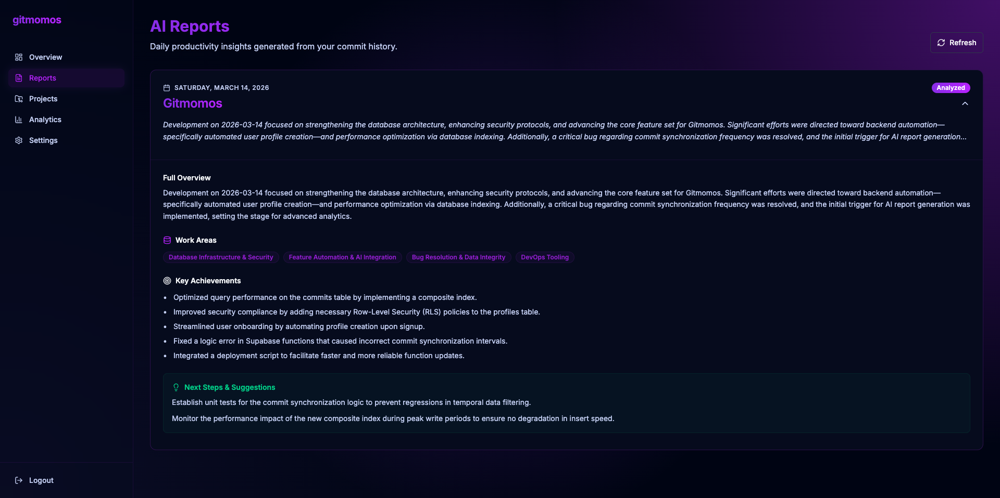

<h1></h1>

**Daily work reports, written from your Git commits.**

Sign up on the website, connect GitHub or Gitea, and pick your repositories. Every night a background worker collects the commits you authored that day and writes a stand-up ready report with Gemini. There's nothing to install and nothing to remember.

---

## ✨ Features

- **🔌 Connect once**: GitHub via OAuth, or any Gitea instance with an access token.
- **🌙 Nightly reports**: one report per day across all your repositories, generated just after midnight in your timezone.
- **🌿 Every branch**: commits are collected from all branches, not just the default one.
- **✏️ Editable**: tweak a report and it is never overwritten by the worker. Copy any report as Markdown.
- **🔄 Sync now**: regenerate today (or any of the last 30 days) on demand.
- **🔒 Metadata only**: commit messages and timestamps are read; source code never is. Tokens live encrypted in Supabase Vault.

---

## 📸 Screenshots

### Dashboard Overview



### Reports



---

## 🏗 Architecture

```
React Router SPA ──(supabase-js, RLS)──► Supabase Postgres
      │                                     ▲   │ pg_cron (hourly)
      │ functions.invoke                    │   ▼ pg_net
      ▼                                     │
 Edge function `connections` ───────────────┤  Edge function `sync`
   GitHub OAuth / Gitea token → Vault       │    fetch commits (GitHub/Gitea API)
   import repository list                   └─── write commits + report (Gemini)
```

- **Frontend** (`app/`): React Router 7 in SPA mode (`ssr: false`), Tailwind, TanStack Query. Public pages are prerendered at build time. The browser only reads its own rows (RLS) and can change just a few columns: name/timezone, which repos are tracked, and report edits.
- **Database** (`supabase/migrations/`): `profiles`, `connections`, `repositories`, `commits`, `reports`. Provider tokens are stored in **Supabase Vault** and are readable only by the service role.
- **`connections` function**: GitHub OAuth start/callback, Gitea connect, refresh repository list.
- **`sync` function**: for one user and one local day, pulls commits from every enabled repository and (re)generates that day's report. It is called by the user ("Sync now") or by the worker.
- **Worker**: `pg_cron` runs `enqueue_daily_syncs()` every hour at :05. Each user whose local time just passed midnight gets one async `pg_net` call to `sync` for the day that ended.

---

## 🚀 Setup

### 1. Prerequisites

- Node.js 20+ (Yarn 4 is vendored in `.yarn/releases`; the global `yarn` command picks it up)
- A [Supabase](https://supabase.com) project
- A [Gemini API key](https://aistudio.google.com/apikey)
- Docker (only for running Supabase locally)

### 2. Install

```bash
yarn install
cp .env.example .env                                  # VITE_SUPABASE_URL, VITE_SUPABASE_ANON_KEY, SUPABASE_PROJECT_ID
cp supabase/functions/.env.example supabase/functions/.env
```

### 3. Database

```bash
npx supabase login
yarn supabase:link
yarn db:push
```

> **Upgrading from v1:** v2 replaces the old schema with a single fresh migration. On an existing project, run `npx supabase db reset --linked` first. **This deletes all v1 data.**

### 4. GitHub OAuth App

Create one at **GitHub → Settings → Developer settings → OAuth Apps**:

- **Homepage URL:** your site, e.g. `https://gitmomos.example.com`
- **Authorization callback URL:** `https://gitmomos.example.com/dashboard/connections/github`

Put the client ID and secret in `supabase/functions/.env`. GitHub allows one callback URL per app, so use a second OAuth App (callback `http://localhost:5173/dashboard/connections/github`) for local development.

> OAuth Apps can only read private repositories with the `repo` scope, so that's what gitmomos requests. It only ever calls read endpoints.

### 5. Worker secret

Generate a shared secret and put it in `supabase/functions/.env` as `WORKER_SECRET`:

```bash
openssl rand -hex 32
```

Then store the same value plus your project URL in Vault (SQL editor), so `pg_cron` can call the `sync` function:

```sql
select vault.create_secret('https://<project-ref>.supabase.co', 'project_url');
select vault.create_secret('<the same WORKER_SECRET>', 'worker_secret');
```

### 6. Deploy edge functions

```bash
yarn secrets:set        # uploads supabase/functions/.env
yarn functions:deploy
```

### 7. Auth settings

In **Supabase → Authentication → URL Configuration**, set the Site URL to your site and add `https://<your site>/dashboard` and `https://<your site>/dashboard/settings` as redirect URLs. These are used by the confirmation and password-reset emails. Signup works with **Confirm email** on or off.

### 8. Deploy the frontend

```bash
yarn build
```

Upload `build/client/` to any static host. Unknown paths must fall back to `/__spa-fallback.html`. `public/_redirects` already does this for Netlify and Cloudflare Pages. On Vercel, add a rewrite of `/(.*)` to `/__spa-fallback.html`.

---

## 🛠 Local development

```bash
yarn db:start           # local Supabase in Docker; applies migrations
yarn functions:serve    # edge functions with supabase/functions/.env
yarn dev                # http://localhost:5173
```

Point `.env` at the local API (`http://127.0.0.1:54321` plus the anon key printed by `npx supabase status`). To test the nightly worker locally, add the Vault secrets with `project_url = 'http://supabase_kong_gitmomos:8000'`, then run `select public.enqueue_daily_syncs();`. To connect a Gitea running on localhost, set `ALLOW_LOCAL_GITEA=true` in `supabase/functions/.env`.

| Script                                                         | What it does             |
| -------------------------------------------------------------- | ------------------------ |
| `yarn dev` / `build` / `preview`                              | Frontend                           |
| `yarn ts:check` / `lint` / `format`                           | Code quality                       |
| `yarn db:push` / `db:reset` / `db:diff` / `db:types`          | Migrations and generated DB types  |
| `yarn functions:serve` / `functions:check` / `functions:deploy` / `secrets:set` | Edge functions   |

### Project structure

```
app/
  root.tsx, routes.ts, global.css
  routes/         URL-mirroring route modules (landing, legal, releases, auth, dashboard/*)
  components/     ui/ primitives + one folder per feature
  hooks/          TanStack Query hooks and stateful logic, by feature
  services/       Supabase client, data access and edge-function calls
  data/ lib/ schemas/ types/
supabase/
  migrations/     v2 schema, RLS, Vault helpers, cron
  functions/
    connections/  connect forges, import repositories
    sync/         collect commits + write a day's report
    _shared/      handlers, provider clients, schemas, constants, helpers
docs/rulebooks/   coding, backend, frontend and git rules (start with CLAUDE.md)
```

Contributors: read [CLAUDE.md](CLAUDE.md) and the rulebook for the area you touch before opening a PR.

---

## 🤝 Contributing

Contributions are what make the open source community such an amazing place to learn, inspire, and create. Any contributions you make are **greatly appreciated**.

1. Fork the project and branch from `main` (`git checkout -b feat/short-slug`)
2. Follow the rulebooks in [`docs/rulebooks/`](docs/rulebooks/) — `yarn build` and `yarn functions:check` must pass
3. Commit with Conventional Commits, one file per commit (`feat(web): add report export`)
4. Open a Pull Request against `main`

---

## 📄 License

Distributed under the MIT License. See `LICENSE` for more information.

---

<p align="center">
  Built with ❤️ by Raviteja Salva
</p>
