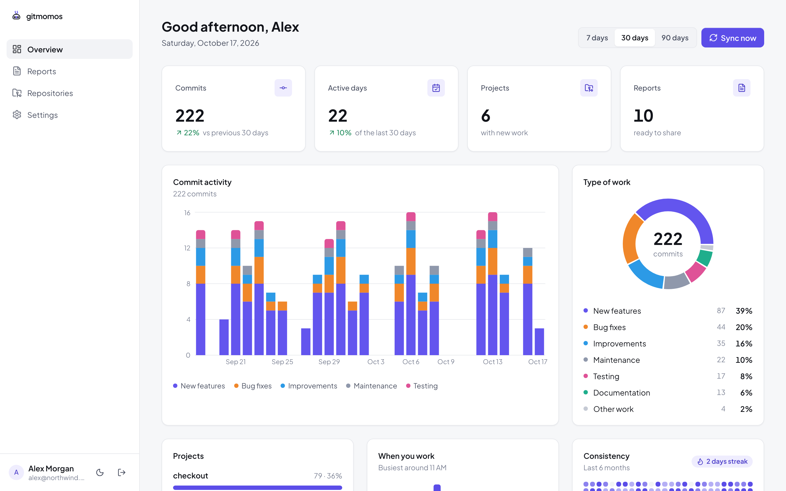
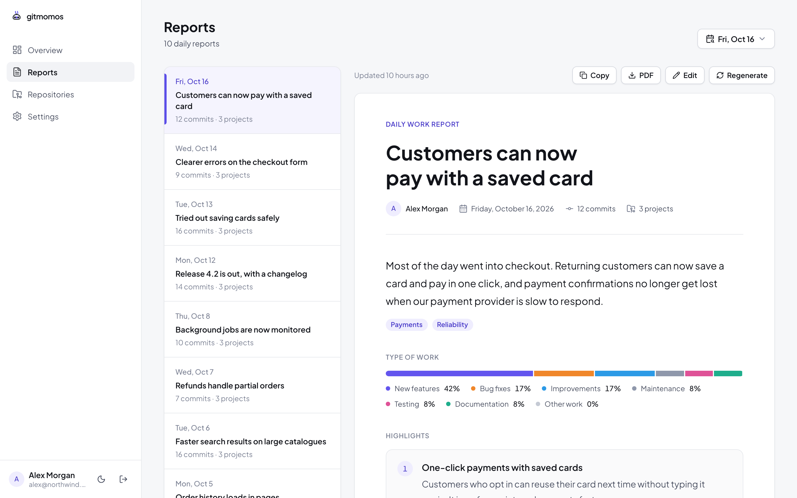
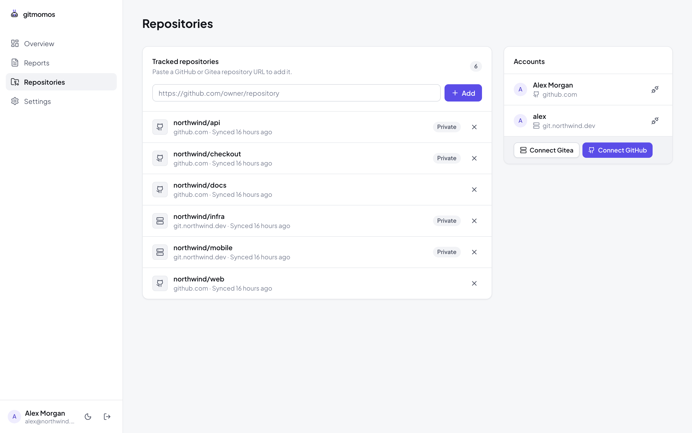

<p align="center">
  <picture>
    <source media="(prefers-color-scheme: dark)" srcset="docs/images/logo-dark.png">
    
  </picture>
</p>

<h3 align="center">Work report automation for developers, written from your Git commits.</h3>

<p align="center">
  <a href="https://gitmomos.spheo.online">Website</a> ·
  <a href="docs/self-hosting.md">Self-hosting</a> ·
  <a href="https://github.com/ravitejas-tech/gitmomos/releases">Releases</a> ·
  <a href="LICENSE">MIT License</a>
</p>

<picture>
  <source media="(prefers-color-scheme: dark)" srcset="docs/images/overview-dark.png">
  
</picture>

gitmomos automates your daily work report: it turns the commits you author each day into a short report that your manager or client can follow. Connect GitHub or Gitea, add the repositories you work in, and every morning yesterday's report is waiting, with charts of where your time went.

There is nothing to install. Sign up at **[gitmomos.spheo.online](https://gitmomos.spheo.online)**, or [host your own copy](docs/self-hosting.md).

---

## ✨ Features

**Reports anyone can read**

- One report per day across all your repositories, written just after midnight in your timezone.
- A headline, a plain-language summary, focus areas, type of work, highlights, a note per project and next steps. No commit hashes, no jargon.
- Copy a report as Markdown, save it as a PDF, or edit any line. Edited reports are never overwritten.
- Jump to any day with the date picker. **Sync now** and **Regenerate** rewrite today or any of the last 30 days on demand.

**Analytics for you**

- Commits, active days, projects and reports for the last 7, 30 or 90 days, compared with the period before.
- Commit activity by type of work, a breakdown by project, the hours you usually work, and a six-month consistency heatmap with your streak.

**Your repositories, your choice**

- GitHub through OAuth, any Gitea instance with an access token, and several accounts at once.
- Add a repository by pasting its URL (HTTPS or SSH). Only the repositories you add are ever read.
- Commits from every branch, matched to you by your login, and on Gitea by your email too.

**Private by design**

- Only commit metadata is read: messages, timestamps and authors. Source code never is.
- Access tokens are encrypted in Supabase Vault, and Row Level Security keeps every user to their own data.
- Light and dark themes.

---

## 📸 Screenshots

### Reports

<picture>
  <source media="(prefers-color-scheme: dark)" srcset="docs/images/reports-dark.png">
  
</picture>

### Repositories

<picture>
  <source media="(prefers-color-scheme: dark)" srcset="docs/images/repositories-dark.png">
  
</picture>

---

## 🏗 How it works

```
React Router SPA ──(supabase-js, RLS)──► Supabase Postgres
      │                                     ▲   │ pg_cron (hourly)
      │ functions.invoke                    │   ▼ pg_net
      ▼                                     │
 Edge function `connections` ───────────────┤  Edge function `sync`
   GitHub OAuth / Gitea token → Vault       │    fetch commits (GitHub/Gitea API)
   user's Gemini API key → Vault            │
   add a repository by URL                  ├─── write commits + report (Gemini)
                                            │
 Edge function `profile-chat` ──────────────┘
   answer a visitor's question from the
   owner's public reports (Gemini embeddings)
```

- **Website** (`app/`): React Router 7 in SPA mode, served as static files. The landing and legal pages are prerendered at build time. The browser reads only its own rows (RLS) and can change just a few columns: name, timezone and public profile settings, whether a repository is tracked or shown on the public profile, and report edits. Visitors read a public profile through `get_public_profile()`, and search and open its shared reports through `search_public_reports()` and `get_public_report()`, which return only what its owner chose to show.
- **Database** (`supabase/migrations/`): `profiles`, `connections`, `repositories`, `commits` and `reports`, plus `report_embeddings` (pgvector) and `profile_questions` for the public profile chatbot. Provider tokens and each user's Gemini API key (`gemini_keys`) live in Supabase Vault and only the service role can read them.
- **`connections` function**: GitHub OAuth, connecting Gitea, adding a repository by URL after checking that the account can read it, and saving a Gemini API key after checking it with Google.
- **`sync` function**: for one user and one local day, collects commits from every tracked repository and writes that day's report with the user's own Gemini key. When a model is overloaded it falls back to the next one. "Sync now" and the nightly worker both call it.
- **`profile-chat` function**: Momi, the public profile chatbot, answers a visitor's question. It embeds the owner's reports with Gemini, finds the closest public ones in Postgres, and has Gemini answer from those alone, citing the days it used.
- **Nightly worker**: `pg_cron` runs `enqueue_daily_syncs()` every hour at :05 and makes one `pg_net` call to `sync` for each user whose local clock has just passed midnight.

| Layer | Choice |
|---|---|
| Website | React 19, React Router 7, Tailwind 4, TanStack Query, Recharts |
| Database | Supabase Postgres with RLS, Vault, `pg_cron` and `pg_net` |
| Functions | Supabase Edge Functions (Deno 2) |
| AI | Gemini over REST with each user's own API key: `gemini-3.5-flash` for reports (falling back to `gemini-3.6-flash`, then `gemini-flash-lite-latest`), `gemini-flash-lite-latest` for the profile chatbot, `gemini-embedding-2` for search |

---

## 🚀 Self-hosting

You need a Supabase project, a GitHub OAuth App and a static host. Each user adds their own free Gemini API key in **Settings**. The short version:

```bash
yarn install
cp supabase/functions/.env.example supabase/functions/.env   # fill in the secrets
yarn supabase login && yarn supabase link --project-ref <project-ref>
yarn db:push
yarn secrets:set && yarn functions:deploy
```

Then add two Vault secrets so the nightly worker can run, set the sign-in URLs in Supabase, and deploy the website. `vercel.json` covers Vercel, and `public/_redirects` covers Netlify and Cloudflare Pages.

**[docs/self-hosting.md](docs/self-hosting.md)** walks through every step, says which dashboard each one happens in, and ends with troubleshooting.

---

## 🛠 Local development

Needs Docker for the local Supabase stack.

```bash
yarn install
cp .env.example .env                                         # VITE_SUPABASE_URL, VITE_SUPABASE_ANON_KEY
cp supabase/functions/.env.example supabase/functions/.env
yarn db:start           # local Supabase in Docker; applies migrations
yarn functions:serve    # edge functions with supabase/functions/.env
yarn dev                # http://localhost:5173
```

- Point `.env` at `http://127.0.0.1:54321` with the anon key that `yarn supabase status` prints.
- GitHub needs its own OAuth App for local development, with the callback `http://localhost:5173/dashboard/connections/github`.
- To try the nightly worker, add the Vault secrets with `project_url = 'http://supabase_kong_gitmomos:8000'`, then run `select public.enqueue_daily_syncs();`.
- To connect a Gitea running on localhost, set `ALLOW_LOCAL_GITEA=true` in `supabase/functions/.env`.

| Scripts | What they do |
|---|---|
| `yarn dev` · `build` · `preview` | Run, build and preview the website |
| `yarn ts:check` · `lint` · `format` | Type-check, lint and format |
| `yarn db:start` · `db:reset` · `db:diff` · `db:types` · `db:push` | Local database, migrations and generated types |
| `yarn functions:serve` · `functions:check` · `functions:deploy` · `secrets:set` | Edge functions |

### Project structure

```
app/
  root.tsx, routes.ts, global.css
  routes/         one module per URL: landing, legal, releases, auth, dashboard/*
  components/     ui/ primitives and one folder per feature
  hooks/          TanStack Query hooks and stateful logic, by feature
  services/       Supabase client, data access and edge-function calls
  data/ lib/ schemas/ types/
supabase/
  migrations/     schema, RLS, Vault helpers, cron
  functions/
    connections/  connect GitHub or Gitea, add repositories
    sync/         collect commits and write a day's report
    _shared/      handlers, provider clients, schemas, constants, helpers
docs/
  self-hosting.md
  rulebooks/      coding, frontend, backend and git rules
  images/         README screenshots and logo
```

---

## 🤝 Contributing

Contributions are welcome.

1. Fork the repository and branch from `main` (`git checkout -b feat/short-slug`).
2. Read [CLAUDE.md](CLAUDE.md) and the [rulebook](docs/rulebooks/) for the area you touch. `yarn build` and `yarn functions:check` must pass.
3. Commit with Conventional Commits, one file per commit (`feat(web): add report export`).
4. Open a pull request against `main`.

---

## 📄 License

MIT. See [LICENSE](LICENSE).

<p align="center">
  Built with ❤️ by <a href="https://github.com/ravitejas-tech">Raviteja Salva</a>
</p>
